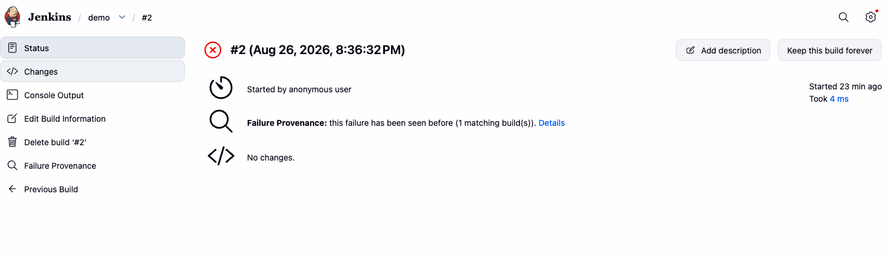
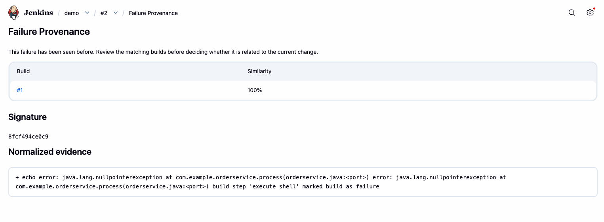

# Failure Provenance Plugin

Failure Provenance helps a Jenkins user answer the first question after a red build: **has this failure happened before?**

For every failed or unstable build, the plugin creates a normalized signature from the relevant console output and compares it with earlier builds of the same job. The build page shows whether the signature is new, how often it has occurred, and links to matching builds.

## Screenshots

On the build page, a summary line tells you immediately whether the failure is new or has been seen before:

Following the **Details** link opens the full report: the matching builds with their similarity, the signature, and the normalized evidence used for comparison.

## What it does

- Extracts a bounded error-focused console excerpt after a failed or unstable build.
- Normalizes volatile values such as timestamps, UUIDs, workspace paths, ports, build numbers, and hex identifiers.
- Stores a SHA-256 signature and a short redacted excerpt with the build.
- Finds exact and near matches among a configurable number of previous builds of the same job.
- Keeps the conclusion evidence-based: it reports recurrence, never claims root cause or automatically retries a build.

## Why use it

When a build goes red, the first triage question is almost always "is this new, or have we seen it before?" Answering it by hand means scrolling console logs across old builds. Failure Provenance answers it on the build page: a new signature is worth investigating as a regression, while a recurring one points you at the earlier builds where it already appeared.

## Installation

1. In Jenkins, go to **Manage Jenkins → Plugins → Available plugins**.
2. Search for **Failure Provenance**.
3. Install it and restart Jenkins if prompted.

No further setup is required; the plugin begins analyzing failed and unstable builds automatically.

## Configuration

After installation, Jenkins administrators can set **Manage Jenkins → System → Failure Provenance → History limit**. The default is 50 previous builds; values from 1 through 500 are supported. Changes apply to subsequently completed builds.

## Current limits

This first release analyzes console output only and compares history within the same Jenkins job. JUnit-aware extraction, multibranch matching, and optional local semantic embeddings are planned follow-ups.

## Contributing and issues

Bug reports, feature ideas, and pull requests are welcome. Please open them on the [GitHub repository](https://github.com/jenkinsci/failure-provenance-plugin/issues). See the [Jenkins plugin development guide](https://www.jenkins.io/doc/developer/) for contribution conventions.

## License

Licensed under the [MIT License](LICENSE).
